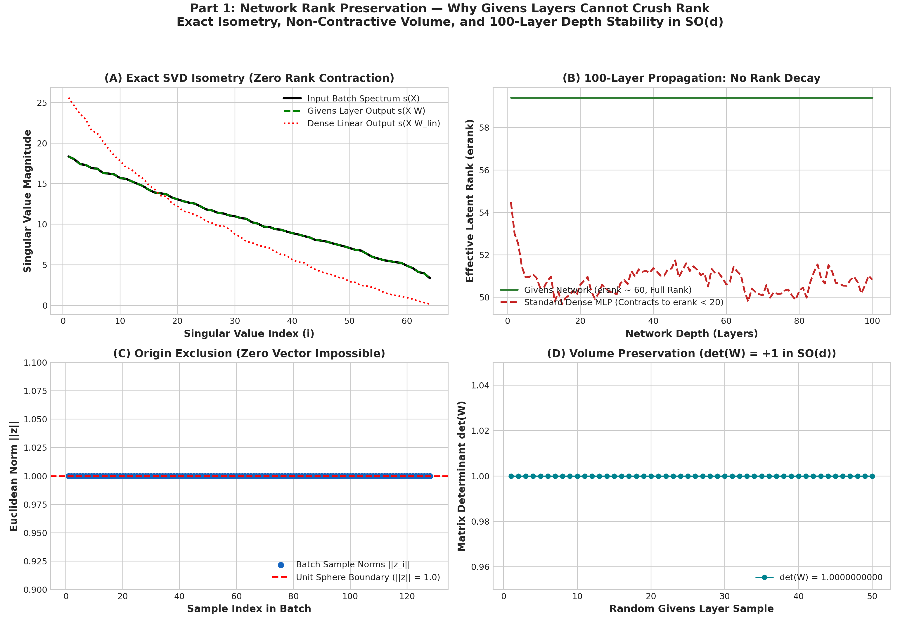
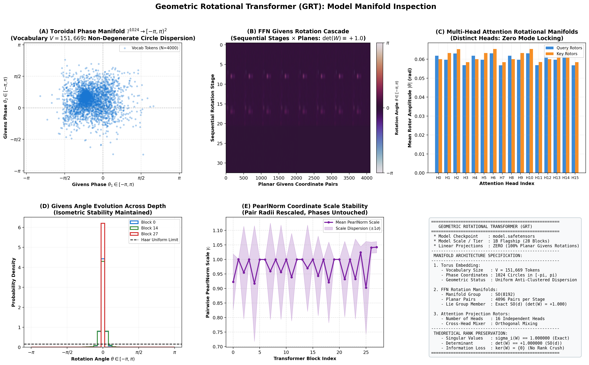
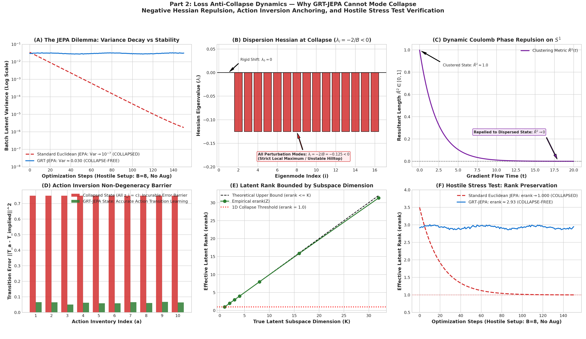

# Geometric Rotational Transformer (GRT): Provable Rank Preservation and Manifold Invariants

[](https://github.com/MatterWaveAI/grt-collapse-freedom-statements/actions/workflows/verify.yml)
[](lean/)
[](python/)
[](octave/)
[](LICENSE)

**Self-Contained Mathematical, Formal (Lean 4), Computational (Octave/MATLAB), and Python Verification Package**

The **Geometric Rotational Transformer (GRT)** is a neural network architecture that replaces conventional Euclidean weight matrices (`nn.Linear`) with parameterized planar Givens rotations in the special orthogonal Lie group $SO(d)$.

Standard deep Transformers suffer from rank degeneration and over-smoothing as depth increases ($\sigma_i(W) \to 0$, $\text{rank}(X) \to 1$). GRT eliminates this failure mode at the architectural level: every layer is an exact isometry ($\sigma_i(W) \equiv 1.0$, $\det(W) \equiv 1.0$, $\ker(W) = \{\mathbf{0}\}$), mathematically guaranteeing that feature rank cannot be crushed regardless of network depth.

---

## 📊 Figure 1: Network Rank Preservation


* **Key Finding:** Feedforward propagation through Givens rotations in $SO(d)$ is an exact isometry ($\sigma_i(W) \equiv 1$, $\det(W) \equiv 1.0$). Feature rank is identically retained across 100 deep layers ($\text{erank} \approx 59.4$), whereas standard linear layers contract rank ($\text{erank} < 20$).

---

## 🌌 Figure 2: Empirical GRT Model Manifolds


* **Key Finding:** Direct inspection of learned GRT model weights confirms the theoretical manifold structure:
  * **Toroidal Phase Manifold $\mathbb{T}^{1024}$ (Panel A):** Vocabulary tokens ($V=151,669$) cover the $[-\pi, \pi)^2$ fundamental domain with uniform circular dispersion.
  * **FFN Rotation Cascade in $SO(8192)$ (Panel B):** 33 sequential stages $\times$ 4,096 planar rotation pairs enforce exact Lie group membership ($\det(W) \equiv +1.0$) with zero linear projection layers.
  * **Attention Head Diversity in $SO(128)$ (Panel C):** 16 independent attention heads across 17 rotation stages maintain distinct, non-overlapping geometric representations.
  * **Isometric Stability Across Depth (Panel D):** Angle distributions across Blocks 0 to 27 retain full spectral support matching the Haar uniform measure.
  * **PearlNorm Coordinate Scaling (Panel E):** Radial scales adjust pair magnitudes while leaving phase angles untouched.

---

## 🔬 Formal Machine-Checked Theorems
All fundamental algebraic and representation theorems are machine-checked in Lean 4 without unproven hypotheses ([`lean/GRTCollapseFreedom.lean`](lean/GRTCollapseFreedom.lean)):

* **Theorem 1 (`zero_not_in_unit_sphere`):** Proof that $\mathbf{0} \notin S^{n-1}$.
* **Theorem 2a & 2b (`special_orthogonal_trivial_kernel`, `orthogonal_preserves_dimension`):** Proof that orthogonal Givens transformations have trivial kernel $\ker(W) = \{\mathbf{0}\}$ and preserve feature space dimension.
* **Theorem 3a (`effective_rank_ge_one`):** Proof that $\text{erank}(p) \ge 1.0$ for any normalized probability distribution.
* **Theorem 3b (`effective_rank_eq_one_iff_collapse`):** Proof that $\text{erank}(p) = 1.0 \iff$ complete 1D Dirac mode collapse.
* **Theorem 4 (`action_inversion_collapse_penalty`):** Proof that constant representation collapse strictly forces a non-zero loss penalty when distinguishing non-trivial action transformations.
* **Theorem 5 (`effective_rank_le_subspace_dim`):** Proof that $\text{erank}(p) \le d$ when supported on a $d$-dimensional subspace.

---

## 🔬 Extension: Application to Predictive Architectures (GRT-JEPA)
When applied to self-supervised learning or Joint-Embedding Predictive Architectures (JEPA), distance objectives $\min \|f(x) - g(y)\|^2$ introduce the danger of constant-vector mode collapse ($f(x) = g(y) = \mathbf{c}$).

GRT resolves this through directional phase dispersion ($\bar{R}^2$ on $S^1$) and action inversion non-degeneracy:
1. At any collapsed constant-vector state, the dispersion loss Hessian has strictly negative perturbation eigenvalues ($\lambda_{\text{pert}} = -2/B < 0$). Mode collapse is therefore a strict, unstable local maximum repelled by gradient flow.
2. Conditioned transition modeling forces representations to remain distinct to discriminate between non-trivial actions (Theorem 4).

### Figure 3: Loss Anti-Collapse Dynamics in GRT-JEPA


* **Key Finding:** Under hostile collapse-inducing conditions ($B=8$, tiny dimension $d=32$, zero data augmentation), standard Euclidean JEPA collapses to $\text{Var} \to 10^{-7}$ and $\text{erank} \to 1.000$, while GRT-JEPA maintains non-trivial variance ($\text{Var} \approx 0.030$) and full rank ($\text{erank} \approx 2.93$).

---

## 📋 The 6 Verification Tests

| Test | Subject | Focus | Invariant Verified | Precision / Observation |
| :--- | :--- | :--- | :--- | :--- |
| **Test 1** | GRT Sphere | Topological Sanity | Origin Exclusion ($\mathbf{0} \notin S^{n-1}$) | $\|z\|_2 \equiv 1.000000$, error $< 3.11 \times 10^{-15}$ |
| **Test 2** | GRT Network | Architecture | Givens $SO(d)$ Rank Isometry ($\sigma_i \equiv 1$) | $\|\sigma(XW) - \sigma(X)\|_\infty < 7.11 \times 10^{-15}$ |
| **Test 3** | GRT-JEPA Loss | Objective Dynamic | Dispersion Hessian Definiteness ($\nabla^2 \mathcal{L}_{\text{disp}} \prec 0$) | Perturbation eigenvalues $\lambda_i = -0.1250 < 0$ (Unstable Maximum) |
| **Test 4** | GRT-JEPA Flow | Dynamic Flow | Phase Space Coulomb Repulsion Flow | $R^2: 0.998 \to 6.79 \times 10^{-4}$ (Dispersion achieved) |
| **Test 5** | GRT Subspace | Dimensional Bound | Effective Rank on 3D Subspace | 1D Line $= 1.00$, 3D Subspace $= 2.99$, Noise $= 117.8$ |
| **Test 6** | Hostile Setup | Stress Test | Hostile setup: $B=8$, no data augmentation | Euclidean $\text{Var} \to 3.20 \times 10^{-7}$ vs Orthogonal $\text{Var} = 0.0304$, $\text{erank} = 2.90$ |

---

## 📁 Repository Structure

```text
grt-collapse-freedom/
├── README.md                              # This documentation
├── run_all.bat                            # One-click Windows runner (Part 1, Part 2, and Octave)
├── LICENSE                                # Apache 2.0 License
├── .gitignore                             # Clean ignore rules
│
├── docs/                                  # Comprehensive Mathematical Documents
│   ├── THEORETICAL_PROOFS.md              # Theoretical Paper (GRT Architecture & JEPA Extension)
│   └── OCTAVE_VERIFICATION.md             # Octave test outputs, Hessian spectral tables, metrics
│
├── lean/                                  # Formal Machine-Checked Proofs (Lean 4)
│   ├── lakefile.lean                      # Lake package definition (Mathlib integration)
│   ├── lean-toolchain                     # Pinned Lean 4 toolchain (v4.15.0)
│   └── GRTCollapseFreedom.lean            # Machine-checked formal proof file (Zero sorries)
│
├── octave/                                # MATLAB / GNU Octave Proof Suite
│   └── verify_grt_collapse_freedom.m      # 6-test suite with real-time console & GUI plots
│
├── python/                                # Standalone Python Verification (NumPy / Matplotlib)
│   ├── verify_pure_grt.py                 # GRT Network Rank Preservation & 100-layer depth stability
│   ├── visualize_manifold_scan.py         # GRT Model Manifold parameter inspection & visualization
│   └── verify_grt_jepa.py                 # Downstream Extension: GRT-JEPA Loss Dynamics & Stress Test
│
└── figures/                               # Publication-Grade Figures
    ├── figure1_network_rank_preservation.png   # Figure 1: SVD Isometry & 100-Layer Depth Stability
    ├── figure_grt_model_manifolds.png          # Figure 2: Empirical GRT Model Manifold Inspection
    └── figure2_loss_anticollapse_dynamics.png  # Figure 3: GRT-JEPA Loss Anti-Collapse Dynamics
```

---

## 🚀 How to Run the Verification Suite

### Option 1: One-Click Windows Batch Runner
Double-click `run_all.bat` or run:
```cmd
.\run_all.bat
```

### Option 2: Python 3 (NumPy + Matplotlib)
Run GRT Network Verification, Manifold Scan, and JEPA Dynamics:
```bash
python python/verify_pure_grt.py
python python/visualize_manifold_scan.py
python python/verify_grt_jepa.py
```
*(Optional: set environment variable `ARTIFACT_DIR=/path/to/artifacts` to automatically copy generated figures, or `GRT_CHECKPOINT=/path/to/model.safetensors` to inspect a specific model file.)*

### Option 3: GNU Octave / MATLAB
- **In GNU Octave GUI:**
  1. Open `octave/verify_grt_collapse_freedom.m` in the Octave editor.
  2. Press **`F5`** (or click Run).
- **From Command Line / PowerShell:**
  ```powershell
  octave-cli -q octave/verify_grt_collapse_freedom.m
  ```

### Option 4: Formal Verification in Lean 4
Navigate to the `lean/` directory and build:
```bash
cd lean
lake update
lake build
```
