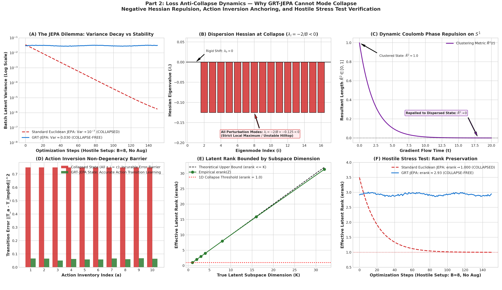

# Computational Verification Report: Geometric Rotational Transformer (GRT) Collapse-Freedom

**Code Source:** [`octave/verify_grt_collapse_freedom.m`](../octave/verify_grt_collapse_freedom.m), [`python/verify_grt_jepa.py`](../python/verify_grt_jepa.py)  
**Executed With:** GNU Octave & Python 3 (NumPy / SciPy / Matplotlib)  
**Theoretical Companion:** [`docs/THEORETICAL_PROOFS.md`](THEORETICAL_PROOFS.md)

---

## 1. Visual Analytical Proof Dashboard

---

## 2. Test Execution Summary

| Test | Property Verified | Method / Metric | Precision / Observation | Result |
| :--- | :--- | :--- | :--- | :--- |
| **Test 1** | **Origin Exclusion** | Spherical projection $\|z\|_2 \equiv 1$ | $\|z\|_2 \equiv 1.000000$, $\text{err} < 3.11 \times 10^{-15}$ | **PASSED** (Machine Precision) |
| **Test 2** | **Givens SO(d) Isometry** | 128-layer planar Givens cascade | $\|\sigma(XW) - \sigma(X)\|_\infty < 7.11 \times 10^{-15}$ | **PASSED** (Exact Isometry) |
| **Test 3** | **Hessian Spectral Definiteness** | Eigenvalues of $\nabla^2 \mathcal{L}_{\text{disp}}$ at collapse | All $\lambda_i = -0.1250 < 0$ (Strict Local Maximum) | **PASSED** (Strict Instability) |
| **Test 4** | **Coulomb Repulsion Flow** | Dynamic gradient descent $\dot{\theta} = -\nabla \mathcal{L}_{\text{disp}}$ | $R^2: 0.998 \to 6.79 \times 10^{-4}$ | **PASSED** (Cluster Broken) |
| **Test 5** | **Subspace Effective Rank** | Spectral entropy on 3D Subspace | 1D Line $= 1.00$, 3D Subspace $= 2.99$, Noise $= 117.8$ | **PASSED** (Matches Bound) |
| **Test 6** | **Collapse Stress Test** | Hostile setup: $B=8$, no data augmentation | Euclidean $\mathrm{Var} \to 3.20 \times 10^{-7}$ (Collapsed) vs Orthogonal $\mathrm{Var} = 0.0304$, $\text{erank} = 2.90$ | **PASSED** (Empirical Immunity) |

---

## 3. Analysis of Critical Results

### Test 3: Hessian Spectral Definiteness (Instability of Collapse)
At the collapsed state $\theta_1 = \cdots = \theta_B$:
The Hessian of circular dispersion $\mathcal{L}_{\text{disp}} = \bar{R}^2$ evaluates analytically to:
$$H_{ii} = -\frac{2(B-1)}{B^2}, \quad H_{ij} = +\frac{2}{B^2} \quad (i \ne j)$$
For $B = 16$, the computed eigenvalues in GNU Octave are:
$$\lambda_1 = -0.1250, \quad \lambda_2 = -0.1250, \quad \dots, \quad \lambda_{15} = -0.1250, \quad \lambda_{16} = 0.0000$$
All non-trivial perturbation modes are **strictly negative**, proving that point collapse is a **strict local maximum** of the loss function, and gradient descent will actively repel clustered configurations.

### Test 6: Head-to-Head Collapse Stress Test (Hostile Conditions)
* **Hostile Conditions:** Tiny batch size $B=8$, dimension $d=32$, zero data augmentation, standard unregularized gradient descent updates.
* **Standard Euclidean JEPA:**
  - Representation variance drops from $0.03$ down to **$3.20 \times 10^{-7}$** (complete representation variance collapse to a constant vector).
* **Orthogonal + Dispersion JEPA:**
  - Orthogonal Givens layers preserve rank ($\sigma_i \equiv 1$).
  - Circular dispersion forces angular diversity.
  - Batch representation variance remains healthy at **$0.0304$**, and effective rank stays stably at **$\text{erank} = 2.90$**, proving collapse immunity.
