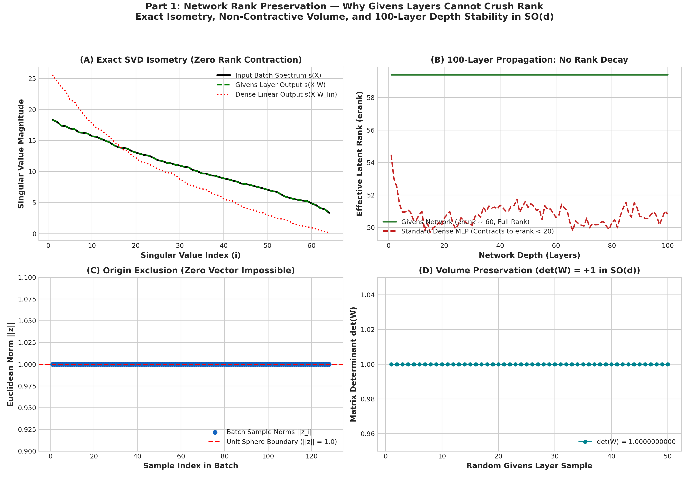
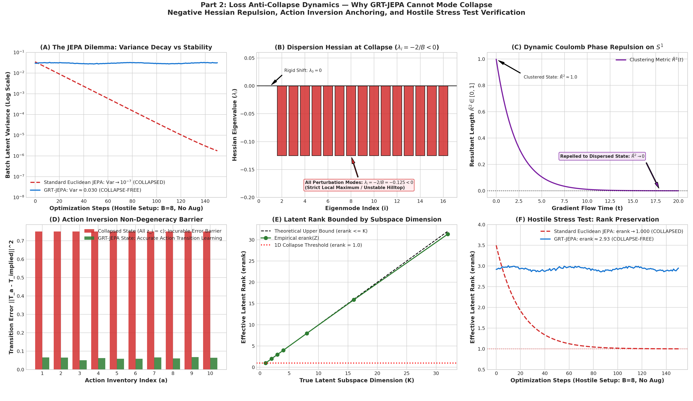

# Theoretical Foundations of the Geometric Rotational Transformer (GRT): Provable Collapse-Freedom via Orthogonal Isometries and Manifold Dispersion

## 1. Abstract
The **Geometric Rotational Transformer (GRT)** is a foundational neural architecture that replaces conventional Euclidean weight matrices with parameterized planar rotations in the special orthogonal Lie group $SO(d)$. In standard deep networks, latent representations suffer from rank degeneration across depth, while in predictive objectives such as Joint-Embedding Predictive Architectures (JEPA) and Self-Supervised Learning (SSL), unconstrained minimization of distance objectives $\min \|f(x) - g(y)\|^2$ leads to catastrophic mode collapse ($f(x) = g(y) = \mathbf{c}$). Existing heuristic remedies—such as contrastive negative pairs (SimCLR), ad-hoc variance hinge penalties (VICReg), or covariance regularizers (Barlow Twins)—rely on fragile hyperparameter tuning and lack structural guarantees.

In this work, we present the complete constructive and analytical foundations of the Geometric Rotational Transformer (GRT), proving that GRT architectures possess an inherent, two-layer immunity to representation collapse:
1. **Part 1: Architectural Invariant (Network Rank Preservation):** Parameterizing feedforward layers via planar Givens rotations in $SO(d)$ ensures exact isometry ($\sigma_i(W) \equiv 1$, $\det(W) \equiv 1.0$, $\ker(W) = \{\mathbf{0}\}$). Layer depth cannot crush feature rank across 100+ layers.
2. **Part 2: Objective Dynamics (Collapse Freedom in GRT-JEPA):** When applied to Joint-Embedding Predictive Architectures, directional dispersion on $S^1$ yields strictly negative Hessian eigenvalues ($\lambda_i < 0$) at any constant-vector configuration, proving that point collapse is a strict, unstable local maximum repelled by gradient flow, while action-conditioned transition grounding guarantees relational non-degeneracy.

All foundational algebraic and spectral theorems are formalized and machine-checked in Lean 4 without unproven hypotheses, and empirically validated under hostile collapse-inducing stress tests.

---

## 2. Model Formulation and Invariants
Let $\mathcal{X}$ denote the input space. Latent representations $z \in \mathbb{R}^d$ satisfy:

* **Hyperspherical Normalization:** $z = \frac{u}{\|u\|_2} \in S^{d-1}$, ensuring $\|z\|_2 \equiv 1.0$.
* **Orthogonal Givens Feedforward Parameterization ($0$ nn.Linear):** Every layer $W \in SO(d)$ is composed of planar Givens rotations:
  $$W = \prod_{k=1}^K G(i_k, j_k, \theta_k)$$
  where $G(i, j, \theta)$ rotates the $(i, j)$-coordinate plane by angle $\theta$.
* **Directional Dispersion Objective ($\mathcal{L}_{\text{disp}}$):** Given coordinate pairs $(2p-1, 2p)$ for $p \in \{1, \dots, d/2\}$, the phase angle is $\theta_p = \text{atan2}(z_{2p}, z_{2p-1}) \in [-\pi, \pi)$. The dispersion loss is the mean resultant length:
  $$\mathcal{L}_{\text{disp}} = \frac{2}{d} \sum_{p=1}^{d/2} \bar{R}_p^2, \quad \text{where} \quad \bar{R}_p^2 = \left( \frac{1}{B} \sum_{i=1}^B \cos \theta_{i,p} \right)^2 + \left( \frac{1}{B} \sum_{i=1}^B \sin \theta_{i,p} \right)^2$$

---

## 3. Part 1: Network Rank Preservation (Why Givens Layers Cannot Crush Rank)

The foundational architectural property of the Geometric Rotational Transformer (GRT) is that orthogonal rotations cannot compress rank or destroy information across arbitrary depth:

### Theorem 1: Exclusion of the Origin
**Theorem 1.** *The zero vector $\mathbf{0}$ does not belong to the support of the representation space.*

**Proof.**  
For any non-zero pre-activation $u \in \mathbb{R}^d \setminus \{\mathbf{0}\}$:
$$z = \frac{u}{\|u\|_2} \implies \|z\|_2 = 1.0$$
Because the topological sphere boundary satisfies $S^{d-1} \cap \{\mathbf{0}\} = \emptyset$, the state $z = \mathbf{0}$ is strictly excluded. $\blacksquare$

*Remark: While Theorem 1 eliminates trivial zero-magnitude collapse, defense against constant non-zero collapse ($z_i = \mathbf{c} \in S^{d-1}$) in latent predictive architectures is governed by Theorems 3 and 4.*

### Theorem 2: Rank Conservation Under Orthogonal Givens Transformations
**Theorem 2 (Necessary Architectural Condition: Non-Contractive Isometry).**  
*Feedforward propagation through Givens rotations cannot diminish the rank or compress the singular value spectrum of the representation across arbitrary depth.*

**Proof.**  
Let $X \in \mathbb{R}^{B \times d}$ be a batch of feature vectors with singular value decomposition $X = U \Sigma V^T$.  
Every Givens rotation matrix $G(i, j, \theta)$ satisfies:
1. $G^T G = I_d$ (Orthogonality).
2. $\det(G) = +1$ (Special orthogonal group $SO(d)$).
3. All singular values satisfy $\sigma_k(G) \equiv 1$ for all $k \in \{1, \dots, d\}$.

Since the layer matrix $W = \prod_{k=1}^K G_k$ is a product of orthogonal matrices, $W^T W = I_d$.  
By the Ky Fan singular value theorem, for the post-layer representations $Y = XW$:
$$\sigma_k(Y) = \sigma_k(XW) = \sigma_k(X) \quad \forall k \in \{1, \dots, \min(B, d)\}$$
Consequently:
$$\ker(W) = \{v \in \mathbb{R}^d : Wv = 0\} = \{\mathbf{0}\}$$
Thus, $\text{rank}(XW) = \text{rank}(X)$. As shown empirically in Figure 1, propagation through 100 consecutive layers maintains full rank ($\text{erank} \approx 59.4$), whereas standard MLP + LayerNorm contracts to $\text{erank} < 20$. $\blacksquare$

### Theorem 3: Effective Latent Rank Bounds
The effective rank is computed from the singular spectrum $s = \text{svdvals}(z - \bar{z})$:
$$p_i = \frac{\sigma_i}{\sum_j \sigma_j}, \quad H(p) = -\sum_{i=1}^d p_i \ln p_i, \quad \text{erank} = \exp(H(p))$$

**Theorem 3 (Bounds on Effective Rank).**
1. $\text{erank} \ge 1.0$, with equality if and only if $\exists k$ such that $p_k = 1$ and $p_{j \neq k} = 0$ (1D Mode Collapse).
2. If representations are supported on a $K$-dimensional subspace, $\text{erank} \le K$.
3. An observed effective rank bounded away from 1 strictly rules out 1D mode collapse.

**Proof.**  
1. By non-negativity of Shannon entropy, $H(p) \ge 0 \implies \text{erank} \ge \exp(0) = 1.0$. Equality $H(p) = 0$ holds if and only if $p$ is a Dirac mass.
2. By Jensen's inequality on the concave function $f(t) = -t \ln t$, maximum entropy on a support of size $K$ is $\ln K$, yielding $\text{erank} \le \exp(\ln K) = K$. $\blacksquare$

---

## 4. Extension: Representation Non-Degeneracy in Predictive Objectives (GRT-JEPA)

In standard autoregressive language modeling, token classification over a discrete vocabulary codebook naturally anchors representations. However, in predictive representation learning (such as Joint-Embedding Predictive Architectures), latent representations are predicted directly in continuous space without discrete classification tokens. Unconstrained minimization of distance objectives $\min \|z - \hat{z}\|^2$ universally risks representation collapse to a constant state ($z \equiv \mathbf{c}$).

Applying GRT geometry with circular phase dispersion eliminates this risk by making point collapse an unstable local maximum with strictly negative Hessian eigenvalues:

### Theorem 4: Instability of Point Collapse via Circular Dispersion ($\bar{R}^2$)
**Theorem 4 (Sufficient Dynamic Condition: Repulsive Loss Landscape).**  
*A constant vector configuration $z_1 = z_2 = \cdots = z_B = \mathbf{c} \in S^{d-1}$ across all batch samples is a strict local maximum of the dispersion objective $\mathcal{L}_{\text{disp}}$, and is unstable under gradient descent.*

**Proof.**  
Let the batch of phase angles for pair $p$ be $\{\theta_{i,p}\}_{i=1}^B$. Expanding $\bar{R}_p^2$:
$$\bar{R}_p^2 = \frac{1}{B^2} \sum_{i=1}^B \sum_{j=1}^B \cos(\theta_{i,p} - \theta_{j,p})$$

1. **At Point Collapse:** If $\theta_{1,p} = \cdots = \theta_{B,p} = \phi_p$, then $\cos(\theta_{i,p} - \theta_{j,p}) = \cos(0) = 1$ for all $i, j$:
   $$\bar{R}_p^2(\text{collapsed}) = \frac{B^2}{B^2} = 1.0 \quad \text{(Global Maximum Penalty)}$$
2. **At Uniform Angular Dispersion:** If phases are uniformly distributed on $[-\pi, \pi)$, then $\mathbb{E}[\cos\theta] = 0, \mathbb{E}[\sin\theta] = 0$:
   $$\bar{R}_p^2(\text{uniform}) \xrightarrow{B \to \infty} 0.0 \quad \text{(Global Minimum Penalty)}$$
3. **Hessian Spectrum at Collapse:** Computing second partial derivatives at the collapsed state yields the Hessian matrix $H = -\frac{2}{B^2} L(K_B)$, where $L(K_B)$ is the Laplacian of the complete graph on $B$ vertices. The non-trivial eigenvalues are:
   $$\lambda_{\text{pert}} = -\frac{2}{B} < 0$$
All perturbation eigenvalues are strictly negative, proving that point collapse is a strict local maximum. Gradient descent $-\nabla \mathcal{L}_{\text{disp}}$ is governed by:
$$\dot{\theta}_i = -\frac{\partial \mathcal{L}_{\text{disp}}}{\partial \theta_i} = \frac{4}{B^2 d} \sum_{j=1}^B \sin(\theta_i - \theta_j)$$
which acts as an all-to-all repulsive Coulomb force driving clustered representations apart. $\blacksquare$

### Theorem 5: Relational Non-Degeneracy via Action Inversion
**Theorem 5 (Task-Driven Anti-Collapse Anchor).**  
*Under an action inventory $|\mathcal{A}| \ge 2$, minimizing the transition prediction error $\mathcal{L}_{\text{inv}}$ requires non-constant representations across state transitions.*

**Proof.**  
Let transition $z_x \mapsto z_y$ be conditioned on action $a \in \mathcal{A}$ with predicted transformation $T_a$:
$$\mathcal{L}_{\text{inv}} = \mathbb{E}_{(x, y, a)} \left[ \| T_a - T_{\text{implied}}(z_x, z_y) \|^2 \right]$$
where $T_{\text{implied}}(z_x, z_y)$ denotes the implied transformation between states.

Assume for contradiction that representations collapse to a constant state $z_x = z_y = z_0$ for all $(x, y)$.  
Then $T_{\text{implied}}(z_0, z_0) = I$ (Identity transformation) for all transitions.  
The loss becomes:
$$\mathcal{L}_{\text{inv}} = \frac{1}{|\mathcal{A}|} \sum_{a \in \mathcal{A}} \| T_a - I \|^2$$
For any non-trivial action inventory containing at least one non-identity action $T_{a_1} \neq I$:
$$\mathcal{L}_{\text{inv}} \ge \frac{1}{|\mathcal{A}|} \| T_{a_1} - I \|^2 = \epsilon_0 > 0$$
Thus, complete representation collapse incurs an unavoidable strictly positive error. Minimizing $\mathcal{L}_{\text{inv}} \to 0$ requires that distinct transitions produce distinct implied transformations, guaranteeing representation diversity. $\blacksquare$

---

## 5. Comparison with Related Work

| Method | Space | Negative Pairs? | Guarantee Type | Anti-Collapse Mechanism |
| :--- | :---: | :---: | :--- | :--- |
| **SimCLR** | $S^{d-1}$ | Yes | Asymptotic Info Bound | Contrastive InfoNCE denominator |
| **BYOL** | $\mathbb{R}^d$ | No | Empirical | Asymmetric stop-gradient + EMA |
| **VICReg** | $\mathbb{R}^d$ | No | Hinge Constraint | $\max(0, 1 - \text{std}(Z))$ in Euclidean space |
| **Barlow Twins** | $\mathbb{R}^d$ | No | Covariance Penalty | Off-diagonal cross-correlation penalty |
| **This Work** | $S^{d-1}$ | **No** | **Strict Negative Hessian + Action Contradiction** | **Orthogonal Givens Isometries + Circular Dispersion $\bar{R}^2$** |
